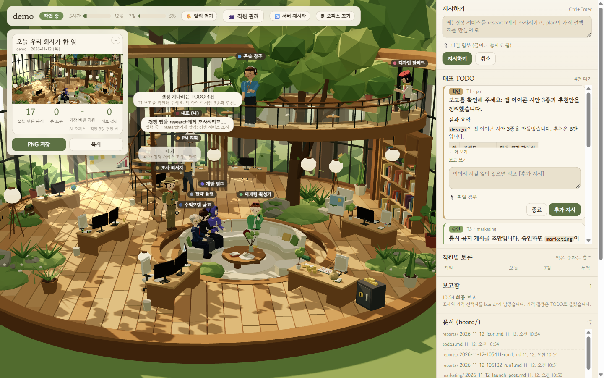
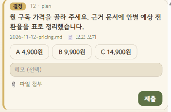
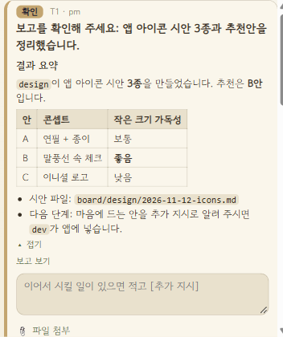
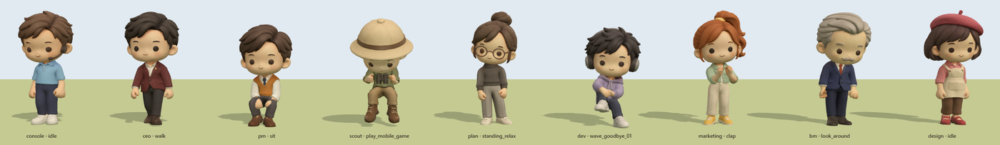
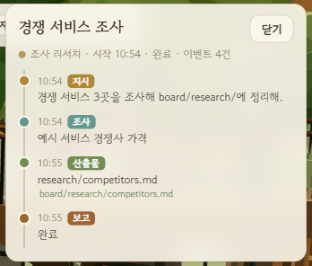
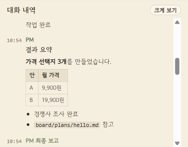
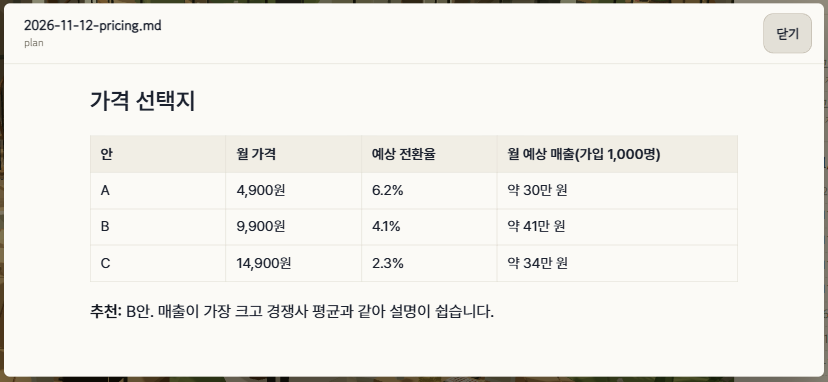
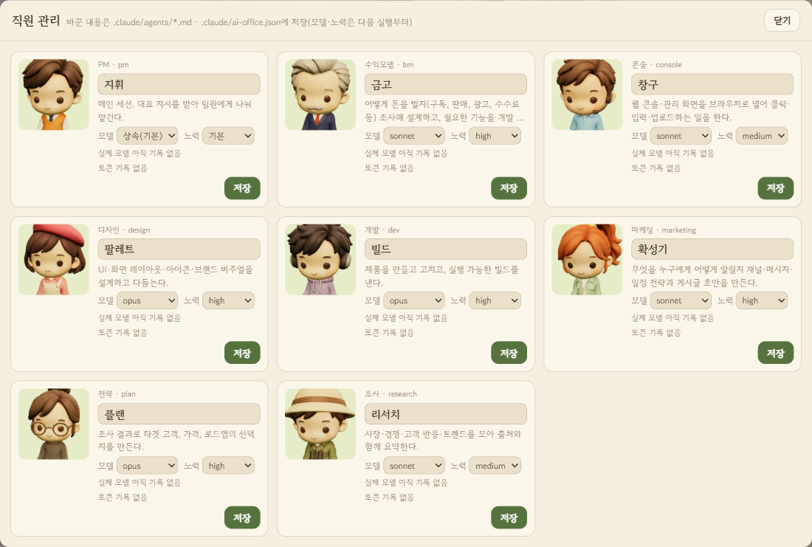

# ai-office: an AI office for solo product builders

[한국어](README.md) | **English**

ai-office is a Claude Code / Codex plugin for people building and shipping apps, games, or SaaS on their own. A PM and a team of AI agents handle research, planning, development, design, and marketing. You give instructions and make decisions. Run `/ai-office:init` once in your project folder to set up the team, work rules, task board, and 3D dashboard.

Templates and prompts are in Korean in v1.



*The office just after a founder asks, "Have research look into competing apps, then have plan put together pricing options." The PM assigns the work. Team members work at their desks or carry documents across the office. Decisions that need the founder go into the TODO panel on the right (`대표 TODO`).*

---

## Why ai-office

When you build a product with AI, **keeping track of sessions** can become more work than the code.

- You open and close Claude Code or Codex sessions for each task.
- Context ends up scattered across sessions. Every morning starts with "Where did I leave off?" and "Which session was that in?"
- When several AI agents work at once, it's easy to lose track of where the project is going.

ai-office gives each agent a fixed role. `research` handles research; `dev` handles development. You can see how work is progressing, which tasks use the most tokens, and where you need to spend your attention.

That's why it has a 3D dashboard and Slack integration. Each instruction starts a thread, and the team discusses the work and reports back there. Come back the next day, read the threads and `board/`, and you can pick up where you left off.

There are a few other recurring problems when you work alone with AI:

- If research, planning, development, and marketing share one conversation, you keep having to explain the roles and rules again.
- Deployments, public posts, and payments need clear limits. You have to decide how far an agent can go on its own.
- Requests like "Pick a price" or "What's the account email?" get buried in long replies.

In ai-office, the PM takes your instructions and assigns work to the team. Each agent finishes what it can within its permissions. Anything that needs your judgment or a personal action goes into `board/todos.md` in a fixed format. You work through that list to make decisions and handle your part.

## What it does

### 1. Set up a team through an interview (`/ai-office:init`)

Describe your product in a sentence and list the main areas of work. The init skill proposes a team in a table. You can change each role's delegation level, model (`opus`, `sonnet`, or `haiku`), and effort level.

| Example role | Work | Default model |
|---|---|---|
| `research` | Market, competitor, and customer research | sonnet |
| `plan` | Audience, pricing, and roadmap options | opus |
| `dev` | Development, builds, and deployment | opus |
| `design` | UI, layout, and visuals | opus |
| `marketing` | Marketing plans and post drafts | sonnet |
| `bm` | Business model design | sonnet |
| `console` | Operating web consoles and admin screens | sonnet |

If you need work outside the templates, such as customer support or bookkeeping, init creates a custom role.

### 2. Choose how much to delegate for each role

| Delegation level | What the agent does | What comes back to you |
|---|---|---|
| Full delegation | Finishes the work | Only payments, signatures, and identity checks become action TODOs (`실행`) |
| Partial delegation | Prepares everything up to the final step that's hard to undo | An approval TODO (`승인`). The agent takes the final step after you approve |
| Human only | No agent is created for this role | The work becomes an action TODO (`실행`) |

Full delegation suits internal work such as research, planning, and drafts. Partial delegation suits deployments and publishing. Human only suits work where you take personal responsibility, such as legal or tax matters.

### 3. Keep everything you need to do in one queue

Your tasks go into `board/todos.md` as one of five types. The Korean labels are the ones used in the dashboard.

| Type | When it appears | What you do |
|---|---|---|
| Decision (`결정`) | The team needs you to choose an option | Click an option button |
| Approval (`승인`) | The next step is hard to undo | Approve or reject |
| Input (`입력`) | The team needs information only you know | Write an answer |
| Action (`실행`) | You need to do something yourself, such as pay or sign | Do it, then confirm it's done |
| Review (`확인`) | The work is finished and the report is ready | Close it or give follow-up instructions |

If the PM raised a decision or approval TODO during the work, it attaches the final report to that item under "View report" (`📄 보고 보기`). It creates a separate review TODO only when the work finishes without a decision to make.

When follow-up work in a thread produces another report, the earlier review TODO closes automatically as "Canceled (replaced by a newer report)." Only the latest review stays open. Decision and approval TODOs, and reviews in other threads, stay as they are.

<table><tr>
<td width="50%"></td>
<td width="50%"></td>
</tr><tr>
<td><b>Decision</b>: a pricing choice raised during the work. The final report is attached to this card, so you don't get a separate review TODO.</td>
<td><b>Review</b>: a report for work that finished without a decision to make. Read the formatted report, then close it or give follow-up instructions.</td>
</tr></table>

You can attach files to new instructions, input answers, and follow-up instructions on reviews. The dashboard saves them in `board/uploads/T<number>/` and adds their paths to your answer. You can send attachments without any text.

Press Ctrl+Enter (Cmd+Enter on Mac) in an input field to submit.

### 4. Save the work in `board/`

Agents save their work to `board/<role>/<date>-<topic>.md`. Decisions go into `board/decisions.md`, activity goes into `board/log.md`, and full final reports go into `board/reports/`. The files stay after the conversation ends.

---

## Dashboard tour

Run `node tools/office.mjs` to open the local dashboard at http://127.0.0.1:4747. When you send an instruction, it starts a PM session through `claude -p`. The floating-island office shows the team's progress as it happens.

### 3D office

- The dashboard reads `.claude/agents/*.md` and gives each team member a desk. Speech bubbles show what they're working on.
- When the PM assigns work, characters carry documents across the office. They bring a report back when they're done.
- Your desk is in the center of the ground floor. The work area is on the left; a large tree and a circular sofa lounge are on the right.
- Idle team members rest on the lounge sofas or climb the spiral stairs to the deck above the tree. They return to their desks when work arrives.
- Drag to rotate the view, scroll to zoom, and double-click to reset the camera.
- Each role has a different character design, with a body about two and a half heads tall. Their expressions change with their state. All characters share walking, sitting, resting, and looking-around animations.



### History cards

Click a team member to see their work history in order: instructions, research, deliverables, and reports.



### Threads

- Each task has a thread. Its title describes the work.
- When you answer a TODO, work continues in the thread that raised it. If your answer starts a different task, such as asking for a marketing plan in a launch thread, haiku checks it and starts a new thread. This costs about $0.002 per batch of answers.
- Open a thread to read the conversation between you, the PM, and the team in order. Add a comment and the PM continues with that context. Final reports stay in the thread too; there is no separate report inbox.
- Click "Close" (`종료`) to stop work in progress. This also removes pending TODOs from that thread. Use "Reopen" (`다시 열기`) to open it again.
- Pending TODO cards also appear inside the thread, where you can answer them. Cards in your TODO queue show task titles. The "Thread" (`스레드`) button opens the related conversation. To close an unneeded TODO without answering, click "Delete" (`지우기`) twice.
- Unread dots mark threads with new messages. Finished threads show the first line of the final report as a preview. Filter by all threads, unread threads, or team member.
- Threads with pending TODOs stay available beyond the usual 7-day or 5,000-line cleanup limits.
- Status badges show "Working" (`작업 중`) or the kind of response needed, such as "Waiting for decision" (`결정 대기`) or "Waiting for review" (`확인 대기`). A thread becomes "Done" (`완료`) when it finishes. It stays pending if it still has TODOs for you, even after the agent stops working.
- When an agent mentions an image (png, jpg, gif, webp, svg), video (mp4, webm, mov), or audio file (mp3, wav, ogg, m4a) in `board/`, the thread shows a thumbnail or player. It also finds files mentioned by absolute path (`C:\…\board\…`) or filename alone.
- Open `board/…md` documents directly inside the thread.

### Chat and document viewer

The right panel keeps the conversation between the PM and the team. It renders Markdown with bold text, tables, lists, and code. Click a `board/` document to read it in the viewer.

<table><tr>
<td width="40%"></td>
<td width="60%"></td>
</tr></table>

### Staff management

See each team member's portrait, role, name, model, effort level, and token usage. The table below shows usage for today, the past 7 days, and all time. Changes go into `.claude/agents/*.md`, or `.claude/ai-office.json` for the PM, and take effect on the next run.



### Other controls

- The daily company summary (`오늘 우리 회사가 한 일`) shows documents created today, tokens used, the busiest team member, and your decision count. Save or copy it as a PNG to share. The minimize button hides the image and keeps the numbers.
- The top gauges show your Claude subscription usage over the 5-hour and 7-day windows.
- "Restart server" (`🔄 서버 재시작`) restarts the dashboard on the same port. Work in progress continues.
- "Turn off office" (`🖥 오피스 끄기`) stops 3D rendering and gives more space to the panels.
- The panels also work on a phone. Tap `+` in the bottom-right corner to send an instruction.

---

## Installation

Claude Code:

```
/plugin marketplace add <owner>/ai-office
/plugin install ai-office@ai-office
```

Then run `/ai-office:init` in the project folder where you want the office.

Codex:

```
codex plugin marketplace add <owner>/ai-office
codex plugin add ai-office@ai-office
```

Then run `$ai-office:init` in Codex, or ask it to "Set up an AI office."

To try a local copy, replace `<owner>/ai-office` with the path to this repository.

## Getting started

1. Run `/ai-office:init` in your project folder and answer the questions.
2. Open a fresh Claude Code session in that folder and describe your goal. The PM assigns work to the team.
3. Start the dashboard:

   ```
   node tools/office.mjs                                          # http://127.0.0.1:4747; instructions run claude -p and use your subscription
   node tools/office.mjs --replay tools/fixtures/demo-run.jsonl   # Replay a demo without using your subscription
   ```

   If you run several offices on one computer, each uses an available port starting at 4747.

## What init creates

| File | Contents |
|---|---|
| `CLAUDE.md` | PM rules, team, and delegation levels |
| `AGENTS.md` | The same instructions for Codex |
| `.claude/agents/<role>.md` | Agent definitions: model, effort, tools, and delegation rules |
| `board/todos.md`, `decisions.md`, `log.md`, `board/<role>/` | Saved project state |
| `.claude/settings.json` | Allowlist and a `git push` deny rule, merged with existing settings |
| `tools/` | Dashboard, if selected |
| `.claude/ai-office-answers.json` | Interview answers to reuse on the next init run |

Init asks before overwriting existing files, so you can run it again safely.

## Updates

- After you update the plugin (`/plugin marketplace update ai-office`), starting the dashboard or clicking "Restart server" syncs the project's `tools/` with the new version.
- It copies files only when the installed plugin version is newer than `tools/.plugin-version`. It won't downgrade. The update replaces any edits you made directly in `tools/`.
- Projects initialized with 0.1.0 need a one-time manual copy of `tools/` and a server restart. Updates are automatic after that.
- To ship dashboard changes, bump `version` in both `.claude-plugin/plugin.json` and `.codex-plugin/plugin.json`.

## Safety and permissions

- The server listens only on 127.0.0.1. The document viewer can read only files inside `board/`. HTML and SVG previews open in a sandbox.
- The dashboard runs the PM with `--permission-mode bypassPermissions`. Use it only in projects you trust.
- Dashboard sessions use `--strict-mcp-config --disable-slash-commands` to keep MCP servers and skills out of the run. This reduces token use and keeps personal connectors out of sessions that bypass permissions. The dashboard's browser agent (`console`) needs a CLI browser tool it can call through Bash. Interactive Claude Code sessions keep using your usual MCP servers and skills.
- Init does not enable permission bypass in `.claude/settings.json`. In interactive sessions, Bash calls from `dev` and `console` ask for approval.
- Dashboard agents run in the foreground with the PM. `claude -p` stops background tasks about 10 minutes after the PM finishes its response.
- Codex users can use `AGENTS.md`, the agent definitions, and `board/`. The live dashboard supports only `claude -p`.

## Telegram notifications (optional)

Create `.office-telegram.env` in your project folder. This file is in `.gitignore`.

```
TELEGRAM_BOT_TOKEN=...
TELEGRAM_CHAT_ID=...
```

- The office bot sends new TODOs and final reports. A final report and its related TODO arrive in one message. Use the buttons to answer.
- Reply to answer a TODO or send a new instruction. Notifications when agents start and finish work are silent.
- To set the address included in messages for remote access, add `OFFICE_URL=https://...` to `.office-telegram.env` or set the `OFFICE_URL` environment variable.
- Without the file, Telegram notifications stay off.

## Slack integration (optional)

Enable Slack during init (`슬랙 연동: 씀`), or follow the setup below for an existing office. Dashboard threads become Slack threads.

- The integration creates a private office channel named `#ai-office-<folder-name>`. Each dashboard thread has a matching Slack thread in that channel.
- The instruction is the first message. If a team member has its own bot, that bot posts its messages. Small gray progress lines that update for each member, final reports, and TODO cards appear as replies. Messages contain the work itself, without decorative emojis or boilerplate.
- Images, video, audio, and Markdown documents from `board/` upload as files you can view in Slack. Each file uploads once. The app needs `files:write`. For an existing app, add it under **OAuth & Permissions** and reinstall the app.
- When a later report in the same thread replaces a review TODO, Slack removes the earlier card and keeps the latest one. The report messages stay in the history.
- Final reports and TODOs mention you so you receive Slack notifications. Reports use Slack Markdown blocks to display headings, tables, and lists.
- A new channel message starts a new instruction. A thread reply becomes a comment for the PM to continue. Clicking a TODO button opens a note dialog. Submit a note, or write a reply such as `T12 반려 색이 어두움` (reject T12 because the color is too dark), to answer the TODO.
- If you answer a TODO in the dashboard or Telegram, Slack removes the card's buttons and shows your answer. Closing or reopening a thread also leaves a record there.
- Threads that existed before you enabled Slack get a header when new work happens in them.
- The office accepts messages only from the founder identified by `SLACK_USER_ID`, because those messages start a PM session that bypasses permissions.
- With a bot for each member (setup step 7), team members join the channel themselves.
  - Mention a member in the channel to work with them directly, such as `@마케팅 경쟁사 SNS 톤 정리해` (ask marketing to summarize competitors' social media tone). That agent handles the task without the PM and reports through its own bot in the thread. It lists work outside its role as items to hand to the PM.
  - Mention a member inside a thread, such as `@개발 이것도 고쳐` (ask development to fix this too), to have them continue it. Replies without a mention go to whoever last handled the thread, either the PM or that agent.
  - Channel messages without a mention go to the PM. When the PM delegates, it posts an actual mention, such as `@마케팅 톤 조사`. When the agent finishes, its bot replies with the start of the result. That bot also posts the task's TODO cards.
- The channel's Canvas tab has a founder TODO board (`대표 TODO 판`). It shows pending items as empty checkboxes and handled items with checks and answers, up to the latest 30 items. Answer through the cards or dashboard; checking a box on the board does not answer a TODO. The app needs `canvases:write`. Add it under **OAuth & Permissions** and reinstall existing apps.
- When a message includes a TODO number such as `T12`, Slack adds the TODO title after it. In the dashboard, hover over the number to see the title, or click it for the contents, status, and answer.
- Socket Mode receives messages without a public URL. Receiving requires Node 22 or newer; older versions can only send. The integration does not yet receive Slack file attachments.

Setup:

1. Go to https://api.slack.com/apps, choose **Create New App → From a manifest**, and select your workspace. Paste the contents of `tools/slack-manifest.json` to create the app.
2. Choose **Install to Workspace**, then copy the *Bot User OAuth Token* (`xoxb-…`) under **OAuth & Permissions**.
3. Under **Basic Information → App-Level Tokens**, create a token (`xapp-…`) with `connections:write`. This receives instructions, comments, and TODO answers from Slack. Without it, the integration only sends messages.
4. Open your Slack profile, click ⋮, and choose **Copy member ID** (`U…`).
5. Create `.office-slack.env` in the project folder. This file is in `.gitignore`.

   ```
   SLACK_BOT_TOKEN=xoxb-...
   SLACK_APP_TOKEN=xapp-...
   SLACK_USER_ID=U...
   ```

   To change the channel name, add `SLACK_CHANNEL=name`. To use an existing channel, add `SLACK_CHANNEL_ID=C...` and invite the bot to it.

6. Start the dashboard server or click "Restart server". It creates the private `#ai-office-<folder-name>` channel and invites you.
7. Optionally, create a bot for each team member. Run `node tools/slack.mjs apps` in the project folder to generate a manifest at `.claude/slack-apps/<member>.json` for each one. Create and install an app from each manifest as in step 1. Add each *Bot User OAuth Token* to `.office-slack.env` as `SLACK_BOT_TOKEN_<UPPERCASE_MEMBER_NAME>=xoxb-...`, such as `SLACK_BOT_TOKEN_MARKETING`, then restart the server. Only the PM app receives messages, so member apps don't need App-Level Tokens. Upload bot profile pictures manually under each app's **Basic Information → Display Information**.
   - Slack's free plan allows 10 installed apps per workspace: the PM app and up to 9 team members. To add more, upgrade the Slack plan and create more apps. The PM bot posts for any member without its own bot.

## Self-checks

```
for f in tools/*.test.mjs skills/init/*.test.mjs; do node "$f"; done
```

There is no build step or npm dependency. You need Node 18 or newer, or Node 22 or newer to receive Slack messages.

## Releases and automation

GitHub Actions workflows live in `.github/workflows/`.

- CI (`ci.yml`) runs the self-checks on main pushes and pull requests. It also checks that both `plugin.json` files have the same `version`.
- The release workflow (`release.yml`) creates a `v<version>` tag and a [GitHub release](https://github.com/yjsplay2002/ai-office/releases) when a push changes the version. Release notes list commit titles since the previous release.
- If the repository has a `CLAUDE_CODE_OAUTH_TOKEN` secret, the same workflow asks Claude Code to read new commits and update both README files. It opens one PR from `readme-auto` and updates that PR on later runs. A person reviews and merges it. Without the secret, the workflow skips this step.
  - To enable it, run `claude setup-token`, then store the token with `gh secret set CLAUDE_CODE_OAUTH_TOKEN`. This uses your subscription. Under repository **Settings → Actions → General**, enable *Allow GitHub Actions to create and approve pull requests*.

## License

[MIT](LICENSE).
