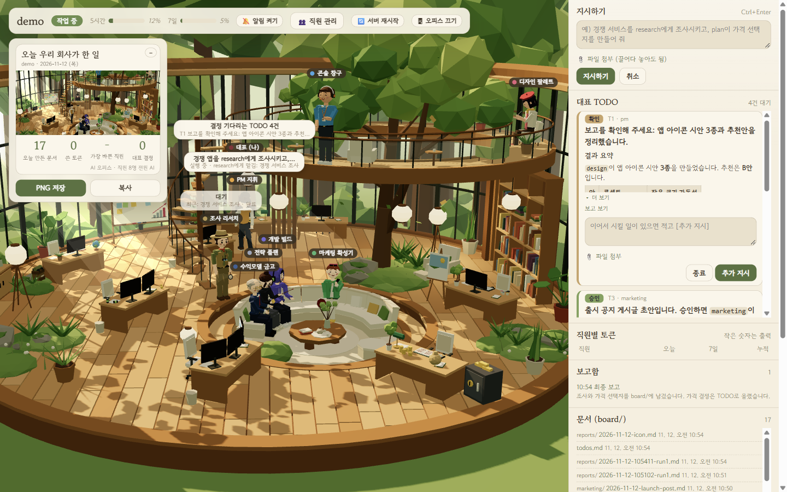
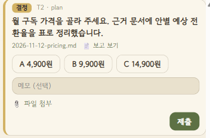
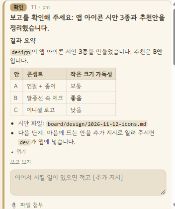
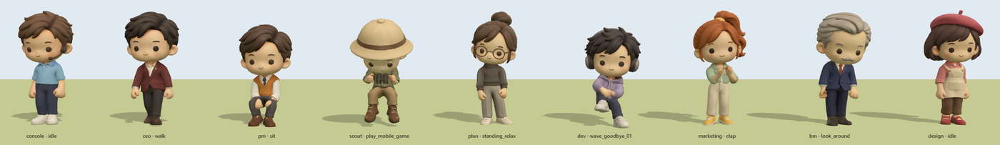
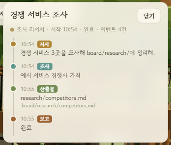
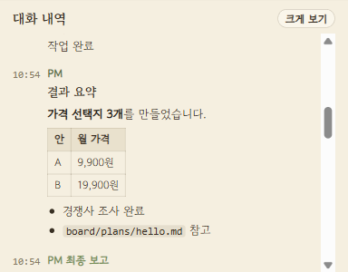
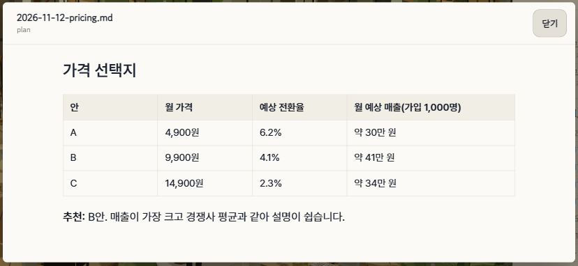
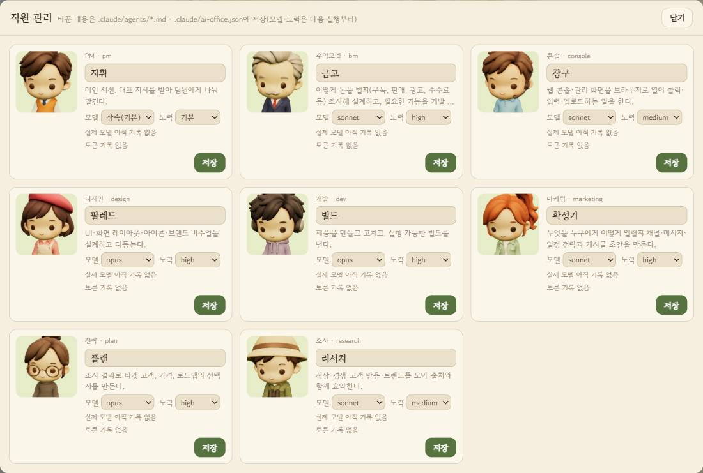

# ai-office — 1인 사업용 AI 오피스

Claude Code 안에 **PM 한 명과 역할별 팀원**을 두고, 대표(나)는 지시하고 결정만 하게 만들어 주는 플러그인입니다. 프로젝트 폴더에서 `/ai-office:init` 한 번이면 팀 구성, 업무 규칙, 할 일 보드, 3D 대시보드가 모두 깔립니다.



*대표가 "경쟁 앱을 research에게 조사시키고, plan이 가격 선택지를 만들어 줘"라고 지시한 직후의 화면입니다. PM이 일을 나누고, 팀원은 책상에서 일하거나 서류를 들고 오가며, 대표가 결정할 일은 오른쪽 `대표 TODO`에 쌓입니다.*

---

## 왜 필요한가

혼자 사업하면서 AI를 쓰면 이런 일이 반복됩니다.

- **매번 처음부터 설명합니다.** 조사, 기획, 개발, 홍보를 같은 대화창에서 하다 보니 역할과 규칙을 매번 다시 말해야 합니다.
- **AI가 어디까지 해도 되는지 애매합니다.** 조사와 초안은 끝까지 맡기고 싶지만, 배포, 게시, 결제처럼 되돌리기 어려운 일은 내가 확인하고 싶습니다. 그 경계를 매번 말로 정해야 합니다.
- **내가 해야 할 일이 대화 속에 묻힙니다.** "가격을 골라 주세요", "계정 이메일을 알려 주세요" 같은 요청이 긴 답변 중간에 섞여 있어 놓치기 쉽습니다.
- **무슨 일이 진행 중인지 안 보입니다.** 여러 작업을 돌리면 누가 무엇을 하고 있는지, 어디까지 됐는지 터미널 로그를 뒤져야 합니다.

ai-office는 이것을 **회사처럼** 정리합니다. PM이 지시를 받아 팀원에게 나누고, 팀원은 정해진 권한 안에서 끝까지 일합니다. 대표가 직접 해야 할 일만 `board/todos.md`에 정해진 형식으로 올라오고, 대표는 그것만 처리하면 됩니다.

## 무엇을 하나

### 1. 인터뷰로 팀을 꾸립니다 (`/ai-office:init`)
사업을 한 줄로 설명하고 주요 업무 영역을 말하면, 팀 구성안을 표 하나로 제안합니다. 역할별로 **위임 수준**과 **모델**을 고칠 수 있습니다.

| 역할(예) | 하는 일 | 기본 모델 |
|---|---|---|
| `research` | 시장, 경쟁, 고객 반응 조사 | sonnet |
| `plan` | 타겟, 가격, 로드맵 선택지 | opus |
| `dev` | 개발, 빌드, 배포 | opus |
| `design` | UI, 레이아웃, 비주얼 | opus |
| `marketing` | 홍보 전략, 게시글 초안 | sonnet |
| `bm` | 수익모델 설계 | sonnet |
| `console` | 웹 콘솔, 관리 화면 조작 | sonnet |

템플릿에 없는 일(고객 응대, 회계 정리 등)은 새 역할로 만들어 줍니다.

### 2. 역할마다 위임 수준을 정합니다

| 위임 수준 | 팀원이 하는 일 | 대표에게 오는 것 |
|---|---|---|
| **AI 전적 위임** | 끝까지 합니다 | 없음(결제, 서명, 본인 확인만 `실행` TODO) |
| **일부 위임** | 되돌리기 어려운 마지막 버튼 직전까지 합니다 | `승인` TODO. 승인하면 팀원이 누릅니다 |
| **사람만** | 팀원을 만들지 않습니다 | 그 일은 `실행` TODO로 |

조사, 기획, 초안 같은 내부 작업은 전적 위임, 배포나 게시처럼 밖으로 나가는 일은 일부 위임, 법무나 세무처럼 사람이 책임지는 일은 사람만으로 추천합니다.

### 3. 대표가 할 일은 TODO 하나로 받습니다
대표가 해야 할 일은 `board/todos.md`에 다섯 가지 형식으로만 올라옵니다.

| 유형 | 언제 | 대표가 하는 일 |
|---|---|---|
| `결정` | 선택지 중 하나를 골라야 할 때 | 보기 버튼을 누름 |
| `승인` | 되돌리기 어려운 일 직전 | 승인 / 반려 |
| `입력` | 대표만 아는 정보가 필요할 때 | 답을 적음 |
| `실행` | 사람이 직접 해야 할 때(결제, 서명 등) | 하고 나서 "했어요" |
| `확인` | 작업이 끝나 보고가 왔을 때 | 종료, 또는 이어서 시킬 일을 "추가 지시" |

**하나의 일은 한 번만 보고합니다.** 작업 중에 PM이 이미 `결정`이나 `승인` TODO를 올렸다면, 끝날 때 `확인`을 따로 만들지 않고 최종 보고를 그 TODO에 붙입니다(`📄 보고 보기`). 결정할 것이 없이 끝난 작업만 `확인`으로 옵니다.

<table><tr>
<td width="50%"></td>
<td width="50%"></td>
</tr><tr>
<td><b>결정</b>: 작업 중에 올라온 가격 결정. 최종 보고가 이 카드에 붙어 있어 따로 <code>확인</code>이 오지 않습니다.</td>
<td><b>확인</b>: 결정할 것 없이 끝난 작업의 보고. 보고 전문이 노션처럼 정리돼 보이고, 종료하거나 추가 지시를 내립니다.</td>
</tr></table>

입력칸에서 **Ctrl+Enter**(맥은 Cmd+Enter)를 누르면 바로 제출됩니다.

### 4. 모든 결과는 `board/`에 남습니다
팀원의 결과물은 `board/<역할>/날짜-주제.md`에, 결정 기록은 `board/decisions.md`에, 작업 로그는 `board/log.md`에, 최종 보고 전문은 `board/reports/`에 쌓입니다. 대화가 끝나도 회사의 기록은 파일로 남습니다.

---

## 대시보드 둘러보기

`node tools/office.mjs`로 여는 로컬 웹 화면입니다(http://127.0.0.1:4747). 지시를 보내면 `claude -p`로 PM 세션이 돌고, 그 과정이 하늘섬 3D 오피스에 실시간으로 그려집니다.

**3D 오피스**
- 팀원은 `.claude/agents/*.md`를 읽어 자기 책상에 앉습니다. 머리 위 말풍선에 지금 하는 일이 보입니다.
- PM이 일을 맡기면 서류를 들고 걸어가 전달하고, 끝나면 보고서를 들고 돌아옵니다.
- 대표 자리는 1층 한가운데입니다. 왼쪽은 책상이 늘어선 업무 공간, 오른쪽은 큰 나무와 원형 소파 라운지입니다.
- 일이 없는 팀원은 라운지 소파나 **나선 계단을 올라 나무 위 2층 데크**에서 쉽니다. 일이 오면 책상으로 돌아갑니다.
- 화면을 드래그하면 돌아가고, 휠로 확대·축소합니다. 더블클릭하면 처음 구도로 돌아갑니다.
- 팀원은 역할마다 생김새가 다른 2.5등신 피규어입니다. 걷기, 앉기, 쉬기, 두리번거리기 같은 동작은 모두가 한 벌을 같이 씁니다.



**히스토리 카드**: 팀원을 누르면 그 사람이 맡은 일의 진행 기록(지시, 조사, 산출물, 보고)이 시간순으로 열립니다.



**스레드**: 작업 하나가 스레드 하나가 됩니다. 제목은 무슨 작업인지(TODO 번호가 아니라) 보여 줍니다. 대표가 TODO에 답하면 새 스레드를 만들지 않고 그 TODO를 올린 작업의 스레드에서 이어 갑니다. 다만 답이 그 스레드 주제와 다른 새 일을 시키면(예: 출시 스레드에서 홍보 계획) 작은 모델(haiku, 답 묶음 한 번에 약 $0.002)이 판단해 새 스레드로 떼어 냅니다. 그리고 최종 보고도 그 스레드 안에 남습니다(따로 보고함은 없습니다). 눌러서 열면 대표·PM·팀원이 주고받은 말이 시간순으로 보이고, 댓글을 달면 PM이 그 맥락을 이어 처리합니다. 진행 중인 일은 `종료`로 멈추고, 이때 그 스레드에서 나온 대기 TODO도 함께 지워집니다. 종료한 스레드는 `다시 열기`로 되살립니다. 그 스레드에서 나온 대기 TODO는 스레드 안에도 카드로 떠서 그 자리에서 답할 수 있습니다. 목록은 새 말이 온 스레드에 점(안 읽음)을 찍고, 끝난 스레드는 미리보기에 결론(최종 보고 첫 줄)을 보여 주며, 전체·안 읽음·직원별로 거를 수 있습니다. 대기 TODO가 걸린 스레드는 7일·5000줄이 지나도 지워지지 않습니다. 대표 TODO 카드에도 번호 대신 그 TODO를 올린 작업 제목이 붙고, `스레드` 버튼을 누르면 그 작업 스레드로 바로 갑니다. 필요 없어진 TODO는 `지우기`(두 번 누름)로 답 없이 닫습니다.

**대화 내역과 문서 뷰어**: PM과 팀원이 주고받은 말이 오른쪽에 쌓입니다. 마크다운(굵게, 표, 목록, 코드)은 노션처럼 정리해서 보여 주고, `board/` 문서는 눌러서 바로 읽습니다.

<table><tr>
<td width="40%"></td>
<td width="60%"></td>
</tr></table>

**직원 관리**: 직원마다 얼굴, 역할, 이름, 모델, 노력 수준, 쓴 토큰을 보고, 아래 표에서 직원별 토큰(오늘·7일·누적)을 한눈에 봅니다. 바꾸면 `.claude/agents/*.md`(PM은 `.claude/ai-office.json`)에 저장되고 다음 실행부터 적용됩니다.



**그 밖에**
- `오늘 우리 회사가 한 일` 카드: 오늘 만든 문서 수, 쓴 토큰, 가장 바쁜 직원, 대표 결정 수를 보여 줍니다. PNG로 저장하거나 복사해서 공유할 수 있습니다. `–`를 누르면 이미지 없이 숫자만 남습니다.
- 상단 게이지: Claude 구독의 5시간, 7일 사용량입니다.
- `🔄 서버 재시작`: 대시보드 서버를 같은 포트로 다시 켭니다. 진행 중인 작업은 끊기지 않습니다.
- `🖥 오피스 끄기`: 3D 렌더링을 멈추고 패널만 크게 봅니다.
- 휴대폰 화면에서도 패널을 쓸 수 있습니다. 지시하기는 오른쪽 아래 `+` 버튼을 누르면 뜹니다.

---

## 설치

Claude Code:
```
/plugin marketplace add <owner>/ai-office
/plugin install ai-office@ai-office
```
그다음 오피스를 차릴 프로젝트 폴더에서 `/ai-office:init`.

Codex:
```
codex plugin marketplace add <owner>/ai-office
codex plugin add ai-office@ai-office
```
그다음 Codex에서 `$ai-office:init`(또는 "AI 오피스 만들어 줘").

로컬 폴더로 써 보기: `<owner>/ai-office` 자리에 이 저장소 경로를 넣습니다.

## 시작하기
1. 프로젝트 폴더에서 `/ai-office:init`을 실행하고 질문에 답합니다.
2. Claude Code를 그 폴더에서 새로 열고 목표를 말합니다. PM이 팀원에게 나눠 맡깁니다.
3. 대시보드를 쓰려면:
   ```
   node tools/office.mjs                                          # http://127.0.0.1:4747 — 지시하면 claude -p 실행(구독 사용량 소모)
   node tools/office.mjs --replay tools/fixtures/demo-run.jsonl   # 사용량 0, 예시 실행 재생
   ```
   한 PC에 오피스가 여럿이면 4747부터 비어 있는 포트를 씁니다.

## init이 만드는 것
| 파일 | 내용 |
|---|---|
| `CLAUDE.md` | PM 규칙 + 팀·위임 수준 표 |
| `AGENTS.md` | Codex용 같은 내용 |
| `.claude/agents/<역할>.md` | 팀원 정의(모델·effort·도구·위임 규칙) |
| `board/todos.md`, `decisions.md`, `log.md`, `board/<역할>/` | 상태 저장소 |
| `.claude/settings.json` | 허용 목록 + `git push` 금지(있으면 병합) |
| `tools/` | 대시보드(골랐을 때) |
| `.claude/ai-office-answers.json` | 인터뷰 답(다시 실행할 때 재사용) |

이미 있는 파일은 묻지 않고 덮어쓰지 않습니다. 다시 실행해도 안전합니다.

## 업데이트
- 플러그인을 업데이트하면(`/plugin marketplace update ai-office`) 다음에 대시보드를 켜거나 `🔄 서버 재시작`을 누를 때 프로젝트의 `tools/`가 새 버전으로 맞춰집니다.
- 설치된 플러그인 버전이 `tools/.plugin-version`보다 높을 때만 덮어씁니다(옛 버전으로 내려가지 않음). `tools/`를 직접 고친 내용은 새 버전으로 바뀝니다.
- 0.1.0 시절에 init한 프로젝트는 한 번만 `tools/`를 새로 복사하고 서버를 껐다 켜야 합니다. 그 뒤로는 자동입니다.
- 배포하는 쪽: 대시보드를 바꿔 내보낼 때는 `.claude-plugin/plugin.json`과 `.codex-plugin/plugin.json`의 `version`을 올려야 사용자에게 전달됩니다.

## 안전과 권한
- 서버는 127.0.0.1에만 열리고, 문서 열람은 `board/` 안 파일만 됩니다. 결과물 미리보기(HTML, SVG)는 샌드박스 안에서 열립니다.
- 대시보드에서 실행되는 PM은 `--permission-mode bypassPermissions`로 돕니다. 믿을 수 있는 프로젝트에서만 쓰세요.
- 대시보드에서 도는 실행은 `--strict-mcp-config --disable-slash-commands`로 MCP 서버와 스킬을 싣지 않습니다(토큰 절약, 그리고 권한 우회 실행에 개인 커넥터를 넣지 않기 위해). 그래서 대시보드 경유의 브라우저 담당(`console`)은 Bash로 부르는 CLI 브라우저 도구가 필요합니다. 대화형 Claude Code 세션에서는 평소 MCP와 스킬을 그대로 씁니다.
- init이 만드는 `.claude/settings.json`에는 권한 우회 모드가 없습니다. 대화형 세션에서 `dev`, `console`의 Bash 호출은 승인을 물어봅니다.
- Codex 사용자는 `AGENTS.md`, 팀원 정의, `board/`를 그대로 쓰지만, 실시간 대시보드는 `claude -p`만 지원합니다.

## 텔레그램 알림 (선택)
프로젝트 폴더에 `.office-telegram.env`를 만듭니다(`.gitignore`에 포함):
```
TELEGRAM_BOT_TOKEN=...
TELEGRAM_CHAT_ID=...
```
- 새 TODO와 최종 보고가 오피스 전용 봇으로 옵니다. 최종 보고는 그 보고가 붙은 TODO와 **한 메시지**로 오고, 버튼으로 바로 답할 수 있습니다.
- 답장으로 TODO에 답하거나 새 지시를 내릴 수 있습니다. 팀원이 일을 시작하고 끝낼 때는 무음 알림이 옵니다.
- 원격으로 열 때 메시지에 넣을 주소는 `.office-telegram.env`에 `OFFICE_URL=https://...` 한 줄을 넣거나 `OFFICE_URL` 환경 변수로 바꿉니다.
- 파일이 없으면 꺼져 있습니다.

## 슬랙 연동 (선택)
init에서 `슬랙 연동: 씀`을 고르거나, 이미 차린 오피스라면 아래만 하면 됩니다. 대시보드의 스레드가 슬랙에 그대로 옮겨집니다.
- 워크스페이스에 오피스 전용 비공개 채널(`#ai-office-<폴더 이름>`)이 생기고, 대시보드 스레드 하나가 그 채널의 슬랙 스레드 하나가 됩니다. 지시가 스레드 첫 글, 팀원 시작·끝, 최종 보고, TODO 카드가 답글로 붙습니다.
- 최종 보고와 TODO에는 대표 멘션이 붙어 슬랙 알림이 옵니다. 보고는 슬랙 markdown 블록이라 제목·표·목록이 그대로 보입니다.
- 채널에 새 글을 쓰면 새 지시, 스레드에 답글을 달면 그 스레드 댓글(PM이 이어 감), TODO 카드 버튼을 누르면 메모 창이 뜨고 보내면 답이 됩니다. 스레드에 `T12 반려 색이 어두움`처럼 써도 답이 됩니다.
- 대시보드·텔레그램에서 답한 TODO는 슬랙 카드의 버튼이 내려가고 답이 적힙니다. 스레드를 종료·다시 열면 그 스레드에도 남습니다.
- 슬랙을 켜기 전에 있던 스레드는 그 스레드에 새 일이 생길 때 머리글이 만들어집니다.
- 대표(`SLACK_USER_ID`) 한 명이 오피스 채널에 쓴 글만 받습니다. 그 글로 권한 우회 PM이 돌기 때문입니다.
- 받기는 Socket Mode라 공개 주소가 필요 없고 Node 22 이상이 필요합니다(그보다 낮으면 보내기만). 슬랙에서 보낸 파일 첨부는 아직 받지 않습니다.

설정:
1. https://api.slack.com/apps → **Create New App → From a manifest** → 워크스페이스를 고르고, 이 프로젝트의 `tools/slack-manifest.json` 내용을 붙여 넣어 만든다.
2. **Install to Workspace**로 설치한 뒤 **OAuth & Permissions**의 *Bot User OAuth Token*(`xoxb-…`)을 복사한다.
3. **Basic Information → App-Level Tokens**에서 `connections:write` 범위로 토큰(`xapp-…`)을 만든다. 슬랙에서 지시·댓글·TODO 답을 받는 데 쓴다(없으면 보내기만).
4. 슬랙에서 자기 프로필 → ⋮ → **멤버 ID 복사**(`U…`).
5. 프로젝트 폴더에 `.office-slack.env`를 만든다(`.gitignore`에 들어 있다):
   ```
   SLACK_BOT_TOKEN=xoxb-...
   SLACK_APP_TOKEN=xapp-...
   SLACK_USER_ID=U...
   ```
   채널 이름을 바꾸려면 `SLACK_CHANNEL=이름`, 이미 있는 채널을 쓰려면 `SLACK_CHANNEL_ID=C...`(봇을 그 채널에 초대).
6. 대시보드 서버를 켜거나 `서버 재시작`을 누르면 비공개 채널 `#ai-office-<폴더 이름>`이 생기고 대표가 초대된다.

## 자체 점검
```
for f in tools/*.test.mjs skills/init/*.test.mjs; do node "$f"; done
```
빌드 단계와 npm 의존성이 없습니다. Node 18+.

---

## English

**ai-office** is a Claude Code / Codex plugin that runs a one-person business like a small company: a PM main session takes your goal and delegates it to persona subagents, and you only handle the decisions that reach `board/todos.md`.

**Why.** Using one chat for research, planning, coding and marketing means re-explaining roles every time, no clear line for what the AI may do on its own (deploys, posts, payments), requests to you buried in long answers, and no view of what is running.

**What it does.**
- `/ai-office:init` (or `$ai-office:init` in Codex) interviews you, proposes a team (research, plan, dev, design, marketing, BM, console, or custom roles), and lets you set each role's delegation level (full / partial: stop before the irreversible step and ask / human only) and model (`opus` / `sonnet` / `haiku`, with effort).
- It writes `CLAUDE.md`, `AGENTS.md`, `.claude/agents/*.md`, `board/`, merges `.claude/settings.json` (keeps a `git push` deny), and optionally copies the dashboard to `tools/`. Existing files are never overwritten without asking.
- Your work queue is `board/todos.md` with five types: decide, approve, input, do-it-yourself, and review. One job reports once: if a run already raised a decision or approval, its final report is attached to that TODO instead of a separate review item.
- The local 3D dashboard (`node tools/office.mjs`, 127.0.0.1:4747, `claude -p` only) shows the team working in a forest office, with speech bubbles, task history, Notion-style markdown in chat, TODOs and reports, a staff editor, usage gauges and a restart button. Idle staff rest in the lounge or on the tree-house deck, and their faces change with their state. See the screenshots above.
- After a plugin update, starting the dashboard (or its restart button) syncs the project's `tools/` when the installed plugin version is newer than `tools/.plugin-version`. Bump `version` in `.claude-plugin/plugin.json` when releasing.
- Optional Slack integration: a private office channel where every dashboard thread is a Slack thread (instructions, progress, reports, TODO buttons, replies as comments), over Socket Mode. Setup: `tools/slack-manifest.json` and `.office-slack.env`.
- Optional Telegram bot for TODOs, reports and replies. Templates and prompts are Korean in v1. MIT licensed.
