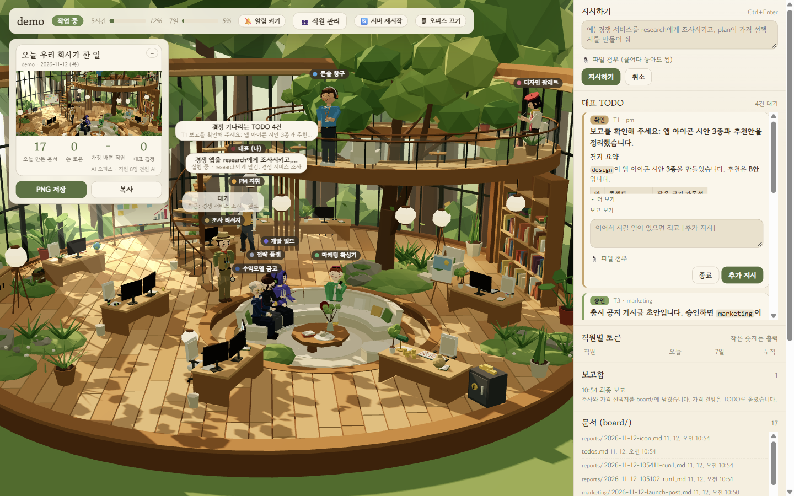
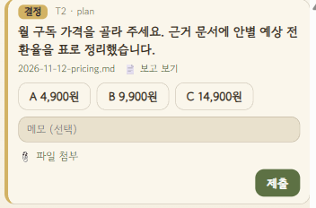
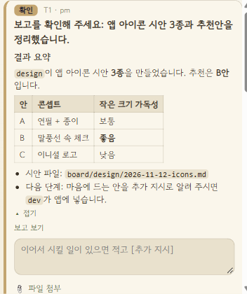
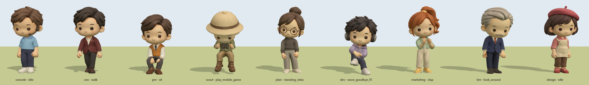
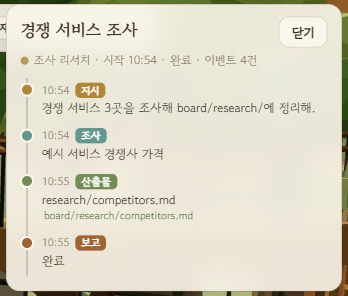
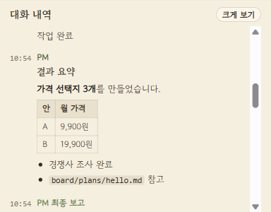
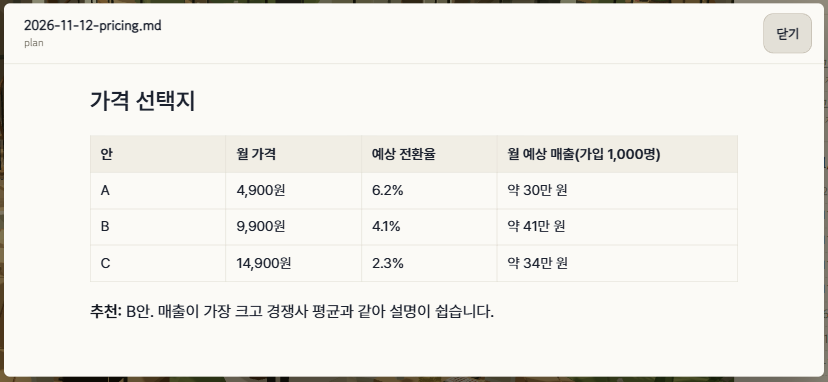
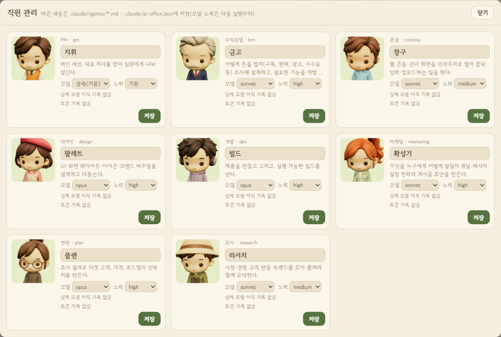

# ai-office: 1인 프로덕트 빌더를 위한 AI 오피스

ai-office는 앱, 게임, SaaS를 혼자 만들고 출시하는 1인 프로덕트 빌더를 위한 Claude Code / Codex 플러그인입니다. 조사, 기획, 개발, 디자인, 마케팅은 PM과 역할별 AI 팀원에게 맡깁니다. 대표는 지시하고 결정합니다. 프로젝트 폴더에서 `/ai-office:init`을 한 번 실행하면 팀 구성, 업무 규칙, 할 일 보드, 3D 대시보드를 설정합니다.



*대표가 "경쟁 앱을 research에게 조사시키고, plan이 가격 선택지를 만들어 줘"라고 지시한 직후의 화면입니다. PM이 일을 나누면 팀원은 책상에서 일하거나 서류를 들고 오갑니다. 대표가 결정할 일은 오른쪽 `대표 TODO`에 쌓입니다.*

---

## 1인 프로덕트 빌더에게 왜 필요한가

AI와 함께 제품을 만들다 보면 코드보다 **세션 관리**가 더 골치 아파집니다.

- 작업마다 Claude Code나 Codex 세션을 열었다 닫았다 해야 합니다.
- 문맥이 세션마다 흩어져서 정리가 안 됩니다. 매일 아침 "어디까지 했지?", "그 작업은 어느 세션에서 했지?"부터 찾습니다.
- AI 여럿과 동시에 일하면 정신이 없고, 프로젝트가 어디로 흘러가는지 놓치기 쉽습니다.

ai-office는 일을 **페르소나별로 나누고, 페르소나마다 하는 일을 고정**합니다. research는 조사만, dev는 개발만 합니다. 그러면 다음이 한눈에 보입니다.

- 일이 지금 어떻게 돌아가고 있는지
- 토큰을 어떤 일에 많이 쓰고 있는지
- 내가 어디에 더 집중해야 하는지

사람들이 슬랙에서 일하듯 3D 대시보드와 슬랙 연동을 만든 이유가 이것입니다. 지시 하나가 스레드 하나가 되고, 팀원이 그 스레드에서 말하고 보고합니다. 다음 날 와도 스레드와 `board/`를 보면 어디까지 했는지 바로 압니다.

그 밖에도 혼자 AI에 일을 맡기면 이런 문제가 남습니다.

- 같은 대화창에서 조사, 기획, 개발, 홍보를 하면 역할과 규칙을 매번 다시 설명해야 합니다.
- 배포, 게시, 결제처럼 되돌리기 어려운 일은 직접 확인해야 합니다. AI가 어디까지 해도 되는지 매번 정해야 합니다.
- "가격을 골라 주세요", "계정 이메일을 알려 주세요" 같은 요청이 긴 답변에 섞여 놓치기 쉽습니다.

ai-office에서는 PM이 지시를 받아 팀원에게 나눕니다. 팀원은 정해진 권한 안에서 끝까지 일하고, 대표의 판단이나 직접 실행이 필요한 일은 `board/todos.md`에 정해진 형식으로 올립니다. 대표는 이 목록에서 결정하고 필요한 일을 처리합니다.

## 무엇을 하나

### 1. 인터뷰로 팀을 꾸립니다 (`/ai-office:init`)

만드는 제품을 한 줄로 설명하고 주요 업무 영역을 말하면 팀 구성안을 표로 제안합니다. 역할별로 위임 수준과 모델을 고칠 수 있습니다.

| 역할(예) | 하는 일 | 기본 모델 |
|---|---|---|
| `research` | 시장, 경쟁, 고객 반응 조사 | sonnet |
| `plan` | 타겟, 가격, 로드맵 선택지 | opus |
| `dev` | 개발, 빌드, 배포 | opus |
| `design` | UI, 레이아웃, 비주얼 | opus |
| `marketing` | 홍보 전략, 게시글 초안 | sonnet |
| `bm` | 수익모델 설계 | sonnet |
| `console` | 웹 콘솔, 관리 화면 조작 | sonnet |

고객 응대나 회계 정리처럼 템플릿에 없는 일은 새 역할로 만듭니다.

### 2. 역할마다 위임 수준을 정합니다

| 위임 수준 | 팀원이 하는 일 | 대표에게 오는 것 |
|---|---|---|
| **AI 전적 위임** | 끝까지 합니다 | 없음(결제, 서명, 본인 확인만 `실행` TODO) |
| **일부 위임** | 되돌리기 어려운 마지막 버튼 직전까지 합니다 | `승인` TODO. 승인하면 팀원이 누릅니다 |
| **사람만** | 팀원을 만들지 않습니다 | 그 일은 `실행` TODO로 |

조사, 기획, 초안 같은 내부 작업에는 전적 위임을 추천합니다. 배포나 게시에는 일부 위임을, 법무나 세무처럼 사람이 책임지는 일에는 사람만을 추천합니다.

### 3. 대표가 할 일은 TODO 하나로 받습니다

대표가 해야 할 일은 `board/todos.md`에 다섯 가지 형식으로만 올라옵니다.

| 유형 | 언제 | 대표가 하는 일 |
|---|---|---|
| `결정` | 선택지 중 하나를 골라야 할 때 | 보기 버튼을 누름 |
| `승인` | 되돌리기 어려운 일 직전 | 승인 / 반려 |
| `입력` | 대표만 아는 정보가 필요할 때 | 답을 적음 |
| `실행` | 사람이 직접 해야 할 때(결제, 서명 등) | 하고 나서 "했어요" |
| `확인` | 작업이 끝나 보고가 왔을 때 | 종료, 또는 이어서 시킬 일을 "추가 지시" |

작업 중에 PM이 `결정`이나 `승인` TODO를 올렸다면 최종 보고를 그 TODO에 붙입니다(`📄 보고 보기`). 이때 `확인`을 따로 만들지 않습니다. 결정할 것 없이 끝난 작업만 `확인`으로 보고합니다.

한 스레드에서 추가 지시 뒤 보고가 이어지면 앞의 `확인`을 "취소 (새 보고로 바뀜)"로 자동으로 닫습니다. 가장 최근 `확인` 하나만 남깁니다. 결정·승인처럼 종류가 다른 TODO와 다른 스레드의 `확인`은 그대로 둡니다.

<table><tr>
<td width="50%"></td>
<td width="50%"></td>
</tr><tr>
<td><b>결정</b>: 작업 중에 올라온 가격 결정. 최종 보고가 이 카드에 붙어 있어 따로 <code>확인</code>이 오지 않습니다.</td>
<td><b>확인</b>: 결정할 것 없이 끝난 작업의 보고. 보고 전문이 노션처럼 정리돼 보이고, 종료하거나 추가 지시를 내립니다.</td>
</tr></table>

새 지시, `입력` 답, `확인`의 추가 지시에는 파일을 첨부할 수 있습니다. 파일은 `board/uploads/T<번호>/`에 저장하고 경로를 답에 붙입니다. 글 없이 첨부만 보내도 됩니다.

입력칸에서 Ctrl+Enter(맥은 Cmd+Enter)를 누르면 바로 제출합니다.

### 4. 모든 결과는 `board/`에 남습니다

팀원의 결과물은 `board/<역할>/날짜-주제.md`에 저장합니다. 결정 기록은 `board/decisions.md`에, 작업 로그는 `board/log.md`에 남깁니다. 최종 보고 전문은 `board/reports/`에 쌓입니다. 대화가 끝나도 기록은 파일로 남습니다.

---

## 대시보드 둘러보기

`node tools/office.mjs`로 로컬 웹 화면을 엽니다(http://127.0.0.1:4747). 지시를 보내면 `claude -p`로 PM 세션을 실행합니다. 하늘섬 3D 오피스에서 진행 상황을 실시간으로 보여 줍니다.

### 3D 오피스

- 팀원은 `.claude/agents/*.md`를 읽어 자기 책상에 앉습니다. 머리 위 말풍선에 지금 하는 일이 보입니다.
- PM이 일을 맡기면 서류를 들고 걸어가 전달하고, 끝나면 보고서를 들고 돌아옵니다.
- 대표 자리는 1층 한가운데입니다. 왼쪽은 책상이 늘어선 업무 공간, 오른쪽은 큰 나무와 원형 소파 라운지입니다.
- 일이 없는 팀원은 라운지 소파에서 쉬거나 나선 계단을 올라 나무 위 2층 데크에서 쉽니다. 일이 오면 책상으로 돌아갑니다.
- 화면을 드래그하면 시점을 돌리고, 휠로 확대·축소합니다. 더블클릭하면 처음 구도로 돌아갑니다.
- 팀원은 역할마다 생김새가 다른 2.5등신 피규어입니다. 걷기, 앉기, 쉬기, 두리번거리기 동작은 모든 팀원이 같은 것을 씁니다.



### 히스토리 카드

팀원을 누르면 맡은 일의 진행 기록을 시간순으로 엽니다. 지시, 조사, 산출물, 보고를 볼 수 있습니다.



### 스레드

- 작업 하나가 스레드 하나가 됩니다. 제목에는 TODO 번호 대신 작업 내용을 보여 줍니다.
- 대표가 TODO에 답하면 그 TODO를 올린 작업의 스레드에서 이어 갑니다. 출시 스레드에서 홍보 계획을 시키는 것처럼 주제가 다른 새 일이면 작은 모델인 haiku가 판단해 새 스레드로 나눕니다. 비용은 답 묶음 한 번에 약 $0.002입니다.
- 스레드를 열면 대표·PM·팀원의 대화를 시간순으로 볼 수 있습니다. 댓글을 달면 PM이 그 맥락을 이어 처리합니다. 최종 보고도 스레드 안에 남으며, 별도 보고함은 없습니다.
- 진행 중인 일은 `종료`로 멈춥니다. 이때 그 스레드에서 나온 대기 TODO도 함께 지웁니다. 종료한 스레드는 `다시 열기`로 다시 엽니다.
- 대기 TODO는 스레드 안에도 카드로 보여 그 자리에서 답할 수 있습니다. 대표 TODO 카드에는 번호 대신 작업 제목이 붙습니다. `스레드` 버튼을 누르면 해당 작업 스레드로 갑니다. 필요 없어진 TODO는 `지우기`를 두 번 눌러 답 없이 닫습니다.
- 목록에서는 새 말이 온 스레드에 안 읽음 점을 찍습니다. 끝난 스레드는 최종 보고 첫 줄을 결론 미리보기로 보여 줍니다. 전체·안 읽음·직원별로 거를 수 있습니다.
- 대기 TODO가 있는 스레드는 7일·5000줄이 지나도 지우지 않습니다.
- 스레드는 진행 중이면 `작업 중`, 대표 답을 기다리면 `결정 대기`·`확인 대기` 같은 TODO 종류를 상태 배지로 표시합니다. 끝난 일에는 `완료`를 붙입니다. 일이 멈췄어도 답할 TODO가 남아 있으면 `완료`로 표시하지 않습니다.
- 팀원이 `board/` 안의 사진(png·jpg·gif·webp·svg), 영상(mp4·webm·mov), 소리(mp3·wav·ogg·m4a)를 언급하면 스레드에 썸네일과 플레이어를 보여 줍니다. 절대 경로(`C:\…\board\…`)나 파일 이름만 써도 찾습니다.
- 스레드에 나온 `board/…md` 문서는 그 자리에서 펼쳐 읽습니다.

### 대화 내역과 문서 뷰어

PM과 팀원이 주고받은 말은 오른쪽에 쌓입니다. 굵게, 표, 목록, 코드 등 마크다운을 노션처럼 보여 줍니다. `board/` 문서는 눌러서 바로 읽습니다.

<table><tr>
<td width="40%"></td>
<td width="60%"></td>
</tr></table>

### 직원 관리

직원마다 얼굴, 역할, 이름, 모델, 노력 수준, 쓴 토큰을 봅니다. 아래 표에는 직원별 토큰을 오늘·7일·누적으로 보여 줍니다. 설정을 바꾸면 `.claude/agents/*.md`(PM은 `.claude/ai-office.json`)에 저장하고 다음 실행부터 적용합니다.



### 그 밖에

- `오늘 우리 회사가 한 일` 카드: 오늘 만든 문서 수, 쓴 토큰, 가장 바쁜 직원, 대표 결정 수를 보여 줍니다. PNG로 저장하거나 복사해서 공유할 수 있습니다. `–`를 누르면 이미지 없이 숫자만 남습니다.
- 상단 게이지: Claude 구독의 5시간, 7일 사용량입니다.
- `🔄 서버 재시작`: 대시보드 서버를 같은 포트로 다시 켭니다. 진행 중인 작업은 끊기지 않습니다.
- `🖥 오피스 끄기`: 3D 렌더링을 멈추고 패널만 크게 봅니다.
- 휴대폰 화면에서도 패널을 쓸 수 있습니다. 지시하기는 오른쪽 아래 `+` 버튼을 누르면 뜹니다.

---

## 설치

Claude Code:

```
/plugin marketplace add <owner>/ai-office
/plugin install ai-office@ai-office
```
그다음 오피스를 차릴 프로젝트 폴더에서 `/ai-office:init`을 실행합니다.

Codex:

```
codex plugin marketplace add <owner>/ai-office
codex plugin add ai-office@ai-office
```
그다음 Codex에서 `$ai-office:init`을 실행하거나 "AI 오피스 만들어 줘"라고 요청합니다.

로컬 폴더로 써 보려면 `<owner>/ai-office` 자리에 이 저장소 경로를 넣습니다.

## 시작하기

1. 프로젝트 폴더에서 `/ai-office:init`을 실행하고 질문에 답합니다.
2. Claude Code를 그 폴더에서 새로 열고 목표를 말합니다. PM이 팀원에게 나눠 맡깁니다.
3. 대시보드는 다음 명령으로 엽니다.
   ```
   node tools/office.mjs                                          # http://127.0.0.1:4747 — 지시하면 claude -p 실행(구독 사용량 소모)
   node tools/office.mjs --replay tools/fixtures/demo-run.jsonl   # 사용량 0, 예시 실행 재생
   ```
   한 PC에 오피스가 여럿이면 4747부터 비어 있는 포트를 씁니다.

## init이 만드는 것

| 파일 | 내용 |
|---|---|
| `CLAUDE.md` | PM 규칙 + 팀·위임 수준 표 |
| `AGENTS.md` | Codex용 같은 내용 |
| `.claude/agents/<역할>.md` | 팀원 정의(모델·effort·도구·위임 규칙) |
| `board/todos.md`, `decisions.md`, `log.md`, `board/<역할>/` | 상태 저장소 |
| `.claude/settings.json` | 허용 목록 + `git push` 금지(있으면 병합) |
| `tools/` | 대시보드(골랐을 때) |
| `.claude/ai-office-answers.json` | 인터뷰 답(다시 실행할 때 재사용) |

이미 있는 파일은 덮어쓰기 전에 묻습니다. 다시 실행해도 안전합니다.

## 업데이트

- 플러그인을 업데이트하면(`/plugin marketplace update ai-office`) 다음에 대시보드를 켜거나 `🔄 서버 재시작`을 누를 때 프로젝트의 `tools/`가 새 버전으로 맞춰집니다.
- 설치된 플러그인 버전이 `tools/.plugin-version`보다 높을 때만 덮어씁니다. 옛 버전으로 내려가지 않습니다. `tools/`를 직접 고친 내용은 새 버전으로 바뀝니다.
- 0.1.0 시절에 init한 프로젝트는 한 번만 `tools/`를 새로 복사하고 서버를 껐다 켜야 합니다. 그 뒤로는 자동으로 업데이트합니다.
- 대시보드를 수정해 배포할 때는 `.claude-plugin/plugin.json`과 `.codex-plugin/plugin.json`의 `version`을 올려야 사용자에게 전달됩니다.

## 안전과 권한

- 서버는 127.0.0.1에만 열립니다. 문서는 `board/` 안의 파일만 열람할 수 있습니다. 결과물 미리보기(HTML, SVG)는 샌드박스 안에서 엽니다.
- 대시보드의 PM은 `--permission-mode bypassPermissions`로 실행합니다. 믿을 수 있는 프로젝트에서만 사용해야 합니다.
- 대시보드 실행은 `--strict-mcp-config --disable-slash-commands`로 MCP 서버와 스킬을 불러오지 않습니다. 토큰을 아끼고 권한 우회 실행에 개인 커넥터가 들어가지 않도록 하기 위해서입니다. 대시보드의 브라우저 담당(`console`)은 Bash로 호출하는 CLI 브라우저 도구가 필요합니다. 대화형 Claude Code 세션에서는 평소 MCP와 스킬을 그대로 씁니다.
- init이 만드는 `.claude/settings.json`에는 권한 우회 모드가 없습니다. 대화형 세션에서 `dev`, `console`의 Bash 호출은 승인을 물어봅니다.
- 대시보드에서 팀원은 PM과 같은 흐름(포그라운드)으로 실행합니다. `claude -p`가 PM 답변 종료 후 ~10분 뒤 백그라운드 작업을 끊기 때문입니다.
- Codex 사용자는 `AGENTS.md`, 팀원 정의, `board/`를 그대로 쓰지만, 실시간 대시보드는 `claude -p`만 지원합니다.

## 텔레그램 알림 (선택)

프로젝트 폴더에 `.office-telegram.env`를 만듭니다. 이 파일은 `.gitignore`에 포함되어 있습니다.

```
TELEGRAM_BOT_TOKEN=...
TELEGRAM_CHAT_ID=...
```

- 새 TODO와 최종 보고가 오피스 전용 봇으로 옵니다. 최종 보고는 해당 TODO와 한 메시지로 옵니다. 버튼으로 바로 답할 수 있습니다.
- 답장으로 TODO에 답하거나 새 지시를 내릴 수 있습니다. 팀원이 일을 시작하고 끝낼 때는 무음 알림이 옵니다.
- 원격으로 열 때 메시지에 넣을 주소는 `.office-telegram.env`에 `OFFICE_URL=https://...` 한 줄을 넣거나 `OFFICE_URL` 환경 변수로 바꿉니다.
- 파일이 없으면 꺼져 있습니다.

## 슬랙 연동 (선택)

init에서 `슬랙 연동: 씀`을 고릅니다. 이미 차린 오피스라면 아래 설정을 따르면 됩니다. 대시보드 스레드를 슬랙 스레드로 옮깁니다.

- 워크스페이스에 오피스 전용 비공개 채널(`#ai-office-<폴더 이름>`)을 만듭니다. 대시보드 스레드 하나가 이 채널의 슬랙 스레드 하나가 됩니다.
- 지시는 스레드 첫 글로 올립니다. 팀원의 말은 해당 팀원 봇이 있으면 그 봇으로 올립니다. 팀원별로 갱신하는 작은 회색 작업 줄, 최종 보고, TODO 카드는 답글로 붙입니다. 이모지나 안내 문구 없이 내용만 올립니다.
- 팀원이 만든 사진·영상·소리와 `board/` 문서(md)를 스레드에 파일로 올립니다. 슬랙에서 바로 볼 수 있으며 같은 파일은 한 번만 올립니다. 앱에 `files:write` 권한이 있어야 합니다. 예전에 만든 앱은 **OAuth & Permissions**에서 `files:write`를 더하고 다시 설치합니다.
- 같은 스레드에서 보고가 이어져 앞 `확인`이 닫히면 그 카드를 지우고 마지막 카드만 남깁니다. 보고 글은 기록으로 남깁니다.
- 최종 보고와 TODO에는 대표 멘션이 붙어 슬랙 알림이 옵니다. 보고는 슬랙 markdown 블록이라 제목·표·목록이 그대로 보입니다.
- 채널의 새 글은 새 지시로 받습니다. 스레드 답글은 해당 스레드의 댓글로 받고 PM이 이어서 처리합니다. TODO 카드 버튼을 누르면 메모 창을 엽니다. 메모를 보내거나 스레드에 `T12 반려 색이 어두움`처럼 쓰면 TODO 답이 됩니다.
- 대시보드·텔레그램에서 TODO에 답하면 슬랙 카드의 버튼을 내리고 답을 적습니다. 스레드를 종료하거나 다시 연 기록도 해당 스레드에 남깁니다.
- 슬랙을 켜기 전에 있던 스레드는 그 스레드에 새 일이 생길 때 머리글이 만들어집니다.
- 대표(`SLACK_USER_ID`) 한 명이 오피스 채널에 쓴 글만 받습니다. 그 글로 권한 우회 PM이 돌기 때문입니다.
- 팀원마다 봇을 만들면(설정 7) 각 팀원이 채널 멤버로 참여합니다.
  - `@마케팅 경쟁사 SNS 톤 정리해`처럼 채널에 쓰면 PM을 거치지 않고 그 팀원이 바로 일하고, 그 스레드에 그 팀원 봇이 보고합니다. 자기 역할 밖의 일은 보고에 "PM에게 넘길 일"로 적습니다.
  - 스레드 안에서 `@개발 이것도 고쳐`처럼 멘션하면 그 팀원이 그 스레드를 이어서 합니다. 멘션 없는 답글은 그 스레드를 마지막으로 맡은 쪽(PM 또는 그 팀원)이 받습니다.
  - 멘션 없이 채널에 쓰면 PM이 받아 나눕니다. PM이 팀원에게 맡길 때 `@마케팅 톤 조사`처럼 진짜 멘션이 스레드에 남고, 끝나면 그 팀원 봇이 결과 첫머리를 답합니다. TODO 카드도 그 일을 한 팀원 봇이 올립니다.
- 채널 위 캔버스 탭에 **대표 TODO 판**이 생깁니다. 대기 중인 TODO는 빈 체크박스, 처리한 TODO는 체크와 답으로 한눈에 보입니다(최근 30개). 답은 카드나 대시보드에서 하고, 판에서 체크해도 답이 되지는 않습니다. 앱에 `canvases:write` 권한이 필요합니다. 예전에 만든 앱이면 **OAuth & Permissions**에서 이 권한을 더하고 다시 설치합니다.
- 글에 `T12` 같은 TODO 번호가 나오면 슬랙에서는 번호 뒤에 그 TODO 제목이 붙습니다. 대시보드에서는 번호에 마우스를 올리면 제목이, 누르면 내용·상태·답이 보입니다.
- 메시지는 Socket Mode로 받으므로 공개 주소가 필요 없습니다. 수신에는 Node 22 이상이 필요하며 그보다 낮으면 보내기만 합니다. 슬랙에서 보낸 파일 첨부는 아직 받지 않습니다.

설정:

1. https://api.slack.com/apps → **Create New App → From a manifest** → 워크스페이스를 고릅니다. 이 프로젝트의 `tools/slack-manifest.json` 내용을 붙여 넣어 앱을 만듭니다.
2. **Install to Workspace**로 설치한 뒤 **OAuth & Permissions**의 *Bot User OAuth Token*(`xoxb-…`)을 복사합니다.
3. **Basic Information → App-Level Tokens**에서 `connections:write` 범위로 토큰(`xapp-…`)을 만듭니다. 슬랙에서 지시·댓글·TODO 답을 받을 때 씁니다. 없으면 보내기만 합니다.
4. 슬랙에서 자기 프로필 → ⋮ → **멤버 ID 복사**(`U…`)를 누릅니다.
5. 프로젝트 폴더에 `.office-slack.env`를 만듭니다. 이 파일은 `.gitignore`에 들어 있습니다.
   ```
   SLACK_BOT_TOKEN=xoxb-...
   SLACK_APP_TOKEN=xapp-...
   SLACK_USER_ID=U...
   ```
   채널 이름을 바꾸려면 `SLACK_CHANNEL=이름`을 넣습니다. 이미 있는 채널을 쓰려면 `SLACK_CHANNEL_ID=C...`를 넣고 봇을 그 채널에 초대합니다.
6. 대시보드 서버를 켜거나 `서버 재시작`을 누르면 비공개 채널 `#ai-office-<폴더 이름>`을 만들고 대표를 초대합니다.
7. (선택) 팀원마다 봇을 만듭니다. 프로젝트 폴더에서 `node tools/slack.mjs apps`를 실행하면 팀원별로 `.claude/slack-apps/<팀원>.json` 매니페스트를 만듭니다. 각 매니페스트로 1번처럼 앱을 만들고 설치합니다. *Bot User OAuth Token*을 `.office-slack.env`에 `SLACK_BOT_TOKEN_<팀원 이름 대문자>=xoxb-...`(예: `SLACK_BOT_TOKEN_MARKETING`)로 넣고 서버를 다시 켭니다. 수신은 PM 앱 하나가 담당하므로 팀원 앱에는 App-Level Token이 필요 없습니다. 봇 프로필 사진은 각 앱의 **Basic Information → Display Information**에서 직접 올립니다.
   - 슬랙 무료 플랜은 워크스페이스에 앱을 **10개**까지 설치할 수 있습니다(PM 앱 + 팀원 9명). 더 필요하면 슬랙 유료 플랜으로 올리고 앱을 더 만듭니다. 봇이 없는 팀원의 알림은 PM 봇이 대신 보냅니다.

## 자체 점검

```
for f in tools/*.test.mjs skills/init/*.test.mjs; do node "$f"; done
```
빌드 단계와 npm 의존성이 없습니다. Node 18+가 필요합니다(슬랙 받기는 22+).

## 변경 내역과 자동화

GitHub Actions 워크플로는 `.github/workflows/`에 있습니다.

- **점검**(`ci.yml`): main 푸시와 PR마다 위 자체 점검을 돌리고, 두 `plugin.json`의 `version`이 같은지 봅니다.
- **릴리스**(`release.yml`): `version`이 바뀐 푸시마다 `v<버전>` 태그와 [GitHub 릴리스](https://github.com/yjsplay2002/ai-office/releases)를 만들고, 앞 릴리스 뒤의 커밋 제목을 변경 내역으로 적습니다.
- **README 갱신 PR**(같은 파일): 저장소 비밀 `CLAUDE_CODE_OAUTH_TOKEN`이 있으면 Claude Code가 새 커밋을 읽고 README를 고쳐 `readme-auto` 브랜치의 PR 하나로 올립니다. 이후 변경도 같은 PR에 반영합니다. 병합 여부는 사람이 판단합니다. 비밀이 없으면 이 단계는 건너뜁니다.
  - 켜는 법: 터미널에서 `claude setup-token`으로 토큰을 받고 `gh secret set CLAUDE_CODE_OAUTH_TOKEN`으로 넣습니다(구독 사용량을 씁니다). 저장소 **Settings → Actions → General**에서 *Allow GitHub Actions to create and approve pull requests*를 켭니다.

---

## English

ai-office is a Claude Code / Codex plugin built for solo product builders who make and ship an app, game, or SaaS. A PM main session takes your goal and delegates research, planning, development, design, and marketing to persona subagents. You direct the work and make decisions through `board/todos.md`.

### Why

Building a product with AI turns session management into the real headache. You open and close a Claude Code or Codex session per task, context scatters across sessions, and every morning starts with "where was I, and which session did that?" Working with several AIs at once, it is easy to lose track of where the project is going.

ai-office splits the work into personas and pins each one to a fixed job. That makes it visible how the work is going, which work is spending the tokens, and where you should focus. This is why it has a dashboard and Slack integration that work like people working in Slack: one instruction becomes one thread, and the team talks and reports in it.

It also removes smaller frictions: re-explaining roles in one chat, deciding each time how far the AI may go before deploys, posts, or payments, and requests for your input buried in long answers.

### Team and work queue

- `/ai-office:init` (or `$ai-office:init` in Codex) interviews you and proposes a team: research, plan, dev, design, marketing, BM, console, or custom roles. You set each role's delegation level (full / partial: stop before the irreversible step and ask / human only) and model (`opus` / `sonnet` / `haiku`, with effort).
- It writes `CLAUDE.md`, `AGENTS.md`, `.claude/agents/*.md`, and `board/`. It merges `.claude/settings.json`, keeping the `git push` deny, and optionally copies the dashboard to `tools/`. It asks before overwriting existing files.
- Your work queue is `board/todos.md` with five types: decide, approve, input, do-it-yourself, and review. If a run already raised a decision or approval, it attaches the final report to that TODO rather than creating a separate review item.

### Dashboard and integrations

- The local 3D dashboard (`node tools/office.mjs`, 127.0.0.1:4747, `claude -p` only) shows the team working in a forest office. It has speech bubbles, task history, Notion-style markdown in chat, TODOs and reports, a staff editor, usage gauges, and a restart button. Idle staff rest in the lounge or on the tree-house deck. Their faces change with their state. See the screenshots above.
- After a plugin update, starting the dashboard or pressing its restart button syncs the project's `tools/` if the installed plugin version is newer than `tools/.plugin-version`. Bump `version` in `.claude-plugin/plugin.json` when releasing.
- Optional Slack integration uses Socket Mode and a private office channel. Each dashboard thread becomes a Slack thread with instructions, progress, reports, TODO buttons, and replies as comments. Each team member can have its own Slack bot. The command `node tools/slack.mjs apps` writes one manifest per member. Mention `@member` to have that member work directly and reply as itself. PM delegations appear as real mentions. Setup uses `tools/slack-manifest.json` and `.office-slack.env`.
- Successive reports in the same thread close the earlier review TODO ("superseded"). Only the latest review TODO stays on the dashboard and in Slack. Threads show status badges (working / waiting on a decision / done), play images, video, and audio inline, and open `board/` markdown in place. TODO answers and new instructions accept file attachments.
- An optional Telegram bot handles TODOs, reports, and replies.

### Automation

CI runs the self-tests on every push. Each version bump creates a GitHub release with the commit log. If the `CLAUDE_CODE_OAUTH_TOKEN` secret is set, Claude Code opens a README update PR.

Templates and prompts are Korean in v1. MIT licensed.
